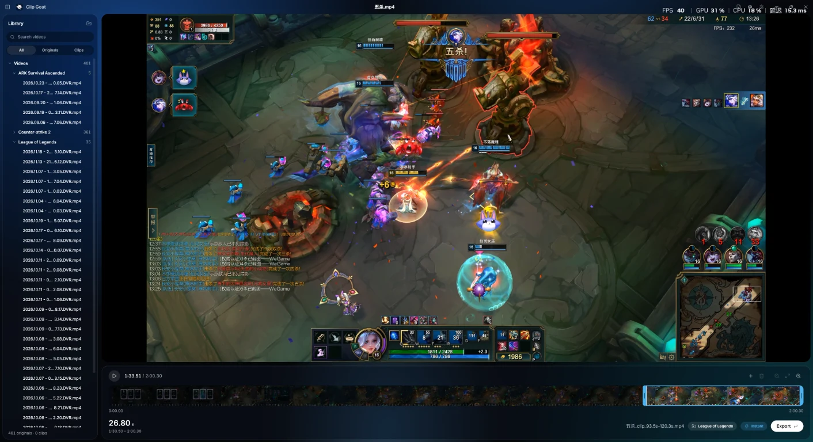

<p align="center"></p>

<h1 align="center">Clip Goat</h1>

<p align="center">English | <a href="README.zh-CN.md">简体中文</a></p>

Clip Goat is a lightweight, hassle-free tool for pulling highlights out of videos and organising your footage. It is powered by ffmpeg, built with Electron and React, and ships with a command-line interface.

## Use cases

Clip Goat suits any situation where the video is long and the part you need is short: game replays, screen recordings, stream archives, security footage, and footage shot on a phone.

Game replays are a typical example. Features such as NVIDIA Instant Replay save the last fixed stretch of gameplay each time. A 2-minute 4K60 recording is about 700 MB, and the part worth keeping is usually a few seconds long. As recordings pile up, they become hard to find and take up a lot of disk space.

<p align="center">
  
</p>

Clip Goat is designed around this workflow:

- On launch, it lists every video in your Videos folder and its subfolders.
- It cuts a few seconds out of a video. When the start sits on a keyframe, nothing is re-encoded and the quality is identical to the original.
- Originals that already have a clip are marked, so you can move them to the Recycle Bin and free up disk space.
- Clips can be exported to a folder you choose, or dragged between folders in the tree.

## Features

- **Library**: browses all videos as a folder tree, tells originals from exported clips, marks originals that already have a clip, and supports search, move, rename and delete.
- **Clipping**: drag the start and end handles on the timeline and export the part between them.
- **Stream copy first**: when the start sits on a keyframe, the audio and video streams are copied without re-encoding, so the quality is identical to the original. Exporting 8 seconds of a 4K60 recording takes about 1 second.
- **Frame-exact cuts**: when the start is not on a keyframe, the range is re-encoded automatically, exact to the frame, at a bitrate no higher than the original.
- **Joining ranges**: several ranges can be selected in one video and are merged in time order into a single file.
- **All audio tracks kept**: the exported file contains every audio track of the source.
- **Formats**: MP4, MKV, MOV and WebM preview directly. For formats such as AVI and FLV, a preview file is generated first; the export still reads the original file.
- **Bundled ffmpeg**: no separate installation is needed.
- **Command line**: the `clip-goat` command uses the same cutting logic as the desktop app.
- **Interface**: dark and light themes, English and Chinese.

## Usage

1. Open a video: drop a file onto the window, or click one in the library on the left.
2. Select a range: drag the handles at either end of the timeline. The preview jumps to the position of the handle.
3. Export: press Enter.

By default the exported file is saved in the same folder as the source video and named `{original-name}_clip_{start}s-{end}s.mp4`, for example `Game_clip_112.5s-115.8s.mp4`. If a file with that name exists, a number is appended; nothing is overwritten.

Two chips sit to the left of the Export button:

- **Destination**: shows the target folder. Click it to change the folder.
- **Export mode**: shows "Instant" (stream copy) or "Exact" (re-encode). Clicking it while it shows "Exact" moves the start back to the previous keyframe and switches to stream copy.

When the pointer is over the preview, play, back and forward buttons appear in the middle of the picture. Back and forward jump 10 seconds by default; right-click either button to change this to 5, 15, 30 or 60 seconds. Volume and playback speed (0.25× to 2×) appear in the bottom-left corner of the picture; both apply to the preview only and do not affect exported files.

While you drag the start handle, it snaps to nearby keyframes. Hold `Alt` to turn snapping off.

### Keyboard shortcuts

| Key | Action |
|---|---|
| `Space` | Play or pause. When playback starts inside the selection, only the selection plays |
| `I` / `O` | Set the start / end to the current position |
| `M` | Mute or unmute |
| `↑` / `↓` | Raise / lower the volume |
| `J` / `L` | Jump back / ahead by the skip amount (10 seconds by default) without stopping playback |
| `←` / `→` | Move one frame; hold `Shift` to move 1 second |
| `S` | Split the range at the current position; outside a range, add a new one |
| `Delete` | Remove the selected range |
| `Enter` | Export |
| `Esc` | Cancel the export |
| `Ctrl+O` | Open a video |
| Mouse wheel | Zoom the timeline; hold `Shift` to pan |

## Library

<p align="center">
  
</p>

The library is the folder tree on the left side of the window. On first launch it contains the system Videos folder and its subfolders, and more folders can be added. Only folders that contain videos are shown.

- **Originals and clips**: a video whose file name contains `_clip_` is treated as an exported clip and shows a scissors icon. An original that already has a clip shows a check mark.
- **Filtering**: show only originals or only clips, or search by file name.
- **File name display**: when a file name begins with the name of its folder, that part is left out. For example, `Game 2026.11.22 - 21.18.21.mp4` inside the `Game` folder is shown as `2026.11.22 - 21.18.21.mp4`. The full name, size and modification time appear in the tooltip.
- **Moving**: drag a video onto the target folder.
- **Right-click a video**: rename, show in folder, move to the Recycle Bin.
- **Right-click a folder**: set as the export destination, show in folder. A top-level folder can also be removed from the library; removing it does not delete any files.

Originals and clips are told apart by file name alone. No database or hidden files are used.

## Command line

```powershell
clip-goat -i Game.mp4 -s 112.5 -e 115.8
```

On success the command prints the path of the exported file to standard output and exits with code 0. On failure it prints the reason to standard error and exits with a non-zero code.

| Option | Description |
|---|---|
| `-i, --input` | Input video |
| `-s, --start` | Start in seconds; decimals allowed |
| `-e, --end` | End in seconds; decimals allowed |
| `--segments` | Several ranges joined in order, written as `start-end,start-end` |
| `-o, --output` | Output path; `.mp4`, `.mov` and `.mkv` are supported |
| `--out-dir` | Output folder; the file name is generated automatically |
| `--fast` | Stream copy from the nearest keyframe before the start |
| `--force-encode` | Always re-encode |
| `--overwrite` | Overwrite an existing output file |
| `--json` | Print the result as JSON |

Without `--fast` or `--force-encode`, the behaviour matches the desktop app: stream copy when the start sits on a keyframe, re-encode otherwise. If stream copy fails, it falls back to re-encoding.

Examples:

```powershell
clip-goat -i Game.mp4 --segments 10-15,42.5-48
clip-goat -i Game.mp4 -s 112.5 -e 115.8 --out-dir D:\clips --json
```

## Installation

No installer has been released yet, so the app has to be built from source. Building requires Node.js 20 or later.

```powershell
git clone <repository-url>
cd clip-goat
npm install
npm run dist
```

The installer is written to the `release` folder as `Clip Goat Setup x.y.z.exe`. It is not code-signed, so Windows shows a SmartScreen prompt the first time it runs.

To use only the command line, run `npm link` after `npm install`. The `clip-goat` command is then available in any directory.

On networks in mainland China, the dependencies need mirrors; see the [Chinese README](README.zh-CN.md#安装).

## Known limitations

- Stream copy can only start on a keyframe, so the start precision of an "Instant" export depends on the keyframe interval of the video.
- Re-encoding produces 8-bit H.264. HDR videos look washed out after re-encoding and should be exported with stream copy.
- The preview and the exported result may differ by one frame, more noticeably with variable-frame-rate videos.
- When ranges are joined, each seam gains about 20 to 100 ms of extra picture. Audio and video stay in sync.

## Development

```powershell
npm run dev      # development mode with hot reload; F12 opens the developer tools
npm start        # build the interface, then launch
npm test         # run the unit tests
```

| Directory | Contents |
|---|---|
| `shared/` | Cutting, video probing and file naming, shared by the desktop app and the command line |
| `cli/` | Command-line entry point |
| `electron/` | Main process: window, local video access, library, export jobs |
| `renderer/` | Interface, React + Vite |
| `assets/` | Icons and logo |

The environment variables `CLIP_GOAT_FFMPEG` and `CLIP_GOAT_FFPROBE` select a different ffmpeg and ffprobe.

## License

Released under GPL-3.0-or-later. The bundled ffmpeg is a GPL build.
