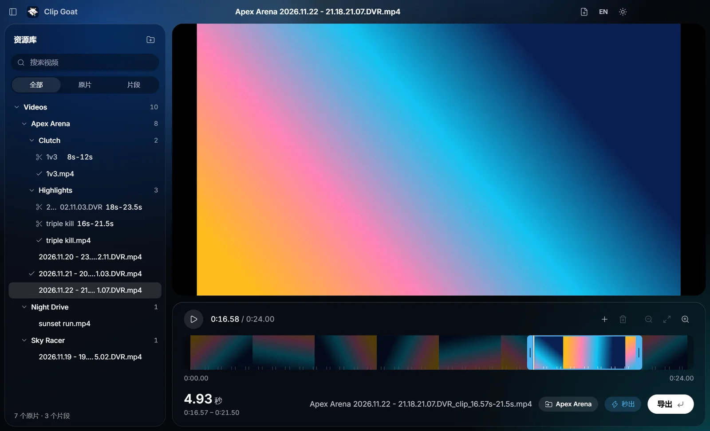
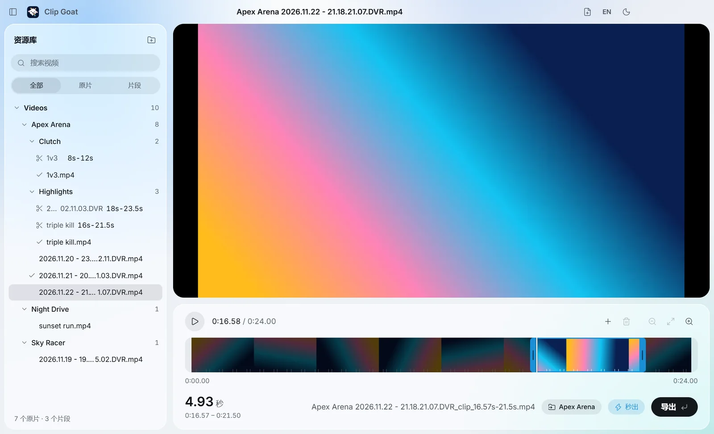

<p align="center"></p>

<h1 align="center">Clip Goat</h1>

<p align="center"><b>两分钟的录像里只想要那五秒？拖两下，回车，完事。</b></p>

<p align="center">
  
</p>

Clip Goat 是一个只做一件事的桌面小工具：从视频里截出你要的那一段。它不是剪辑软件，没有轨道、特效和工程文件，打开就能用。

## 为什么用它

- **三步出片**：把视频拖进来，拖两个手柄框住想要的部分，按回车。新文件就出现在原视频旁边。
- **秒出，而且不损画质**：起点落在关键帧上时直接复制画面，不重新编码。一段 8 秒的 4K60 游戏录像大约 1 秒导出，画质和原片完全一样。
- **想精确到帧也不用操心**：起点不在关键帧上时，它会自动改为重新编码这一小段。按钮旁的标记会提前告诉你这次是"秒出"还是"精确"，点一下标记就能把起点对齐到关键帧。
- **多段拼成一条**：按 `S` 切出多个片段，导出时按顺序拼成一个文件。
- **声音不会错位**：用带声画标记的测试视频量过，三种导出方式的音画偏差都在 1 毫秒以内；多条音轨（比如游戏声和麦克风）全部保留。
- **录像再多也找得到**：左侧的资源库是一棵文件夹树，原片和剪出来的片段一眼分得清，剪过的原片会打勾。
- **什么格式都能开**：MP4、MKV、MOV、WebM 直接预览；AVI、FLV 这类老格式会自动生成预览，导出仍然用原文件。
- **不用装 ffmpeg**：已经内置。
- **脚本也能调**：附带一个命令行工具，和应用用的是同一套裁切逻辑。

## 怎么用

1. **打开**：把视频拖进窗口，或者在左侧资源库里点一个。
2. **选片段**：拖时间轨两端的手柄，预览会跟着跳到手柄所在的画面。也可以边播边按 `I` 定起点、`O` 定终点。
3. **导出**：按回车。文件名自动生成，例如 `Game_clip_112.5s-115.8s.mp4`，重名时自动加序号，不会覆盖已有文件。

| 按键 | 作用 |
|---|---|
| `空格` | 播放或暂停；在选区内开始播放时只播选区 |
| `I` / `O` | 把起点 / 终点设到当前画面 |
| `←` / `→` | 逐帧移动，按住 `Shift` 每次 1 秒 |
| `S` | 在当前位置切开片段，或者新增一个片段 |
| `Delete` | 删除选中的片段 |
| `回车` | 导出 |
| `Esc` | 取消导出 |
| 滚轮 | 缩放时间轨，`Shift` + 滚轮平移 |

拖动起点手柄靠近关键帧时会自动吸附，按住 `Alt` 可以临时关闭。

## 管理一堆录像

<p align="center">
  
</p>

- **文件夹树**：首次启动自动加入系统的"视频"文件夹，子文件夹一起显示；也可以再添加别的文件夹。
- **一眼分清**：剪出来的片段带剪刀图标，已经剪过的原片带对勾。可以只看原片或只看片段，也可以按名字搜索。
- **名字不啰嗦**：文件名开头和所在文件夹同名的部分不重复显示。
- **整理**：把视频拖到文件夹上就是移动；右键可以重命名、在文件夹中显示、移到回收站。
- **导出到哪**：默认在原视频旁边；右键任意文件夹可以把它设为导出位置。

片段和原片靠文件名里的 `_clip_` 区分，不依赖数据库或隐藏文件，所以你用别的工具移动、备份这些文件都不会乱。

## 命令行

```powershell
clip-goat -i Game.mp4 -s 112.5 -e 115.8
# 输出 Game_clip_112.5s-115.8s.mp4 的完整路径

clip-goat -i Game.mp4 --segments 10-15,42.5-48      # 两段拼成一条
clip-goat -i Game.mp4 -s 112.5 -e 115.8 --fast      # 一定秒出，起点可能提前一点
clip-goat -i Game.mp4 -s 112.5 -e 115.8 --out-dir D:\clips --json
```

| 参数 | 说明 |
|---|---|
| `-i, --input` | 输入视频 |
| `-s, --start` / `-e, --end` | 起止秒数，支持小数 |
| `--segments` | 多个片段按顺序拼接：`起-止,起-止` |
| `-o, --output` | 指定输出路径（`.mp4` / `.mov` / `.mkv`） |
| `--out-dir` | 保留自动文件名，写到指定文件夹 |
| `--fast` | 从起点之前最近的关键帧开始直接复制 |
| `--force-encode` | 强制重新编码 |
| `--overwrite` | 输出文件已存在时覆盖 |
| `--json` | 以 JSON 输出结果 |

成功时在 stdout 输出文件路径，退出码为 0；失败时把原因写到 stderr，退出码非 0。

## 安装

目前还没有发布现成的安装包，需要从源码打一个（Node.js 20 以上）：

```powershell
git clone <本仓库地址>
cd clip-goat
npm install
npm run dist        # 生成 release\Clip Goat Setup x.y.z.exe
```

只想用命令行的话，`npm install` 之后运行 `npm link`，就可以在任意目录使用 `clip-goat`。

<details>
<summary>国内网络安装依赖</summary>

Electron 和 ffmpeg 的二进制需要走镜像：

```powershell
$env:ELECTRON_MIRROR="https://npmmirror.com/mirrors/electron/"
$env:ELECTRON_BUILDER_BINARIES_MIRROR="https://npmmirror.com/mirrors/electron-builder-binaries/"
$env:FFMPEG_BINARIES_URL="https://cdn.npmmirror.com/binaries/ffmpeg-static"
npm install --registry=https://registry.npmmirror.com
```

</details>

## 常见问题

**"秒出"和"精确"差在哪？**
视频只能从关键帧开始直接复制。起点正好在关键帧上就是秒出；否则要重新编码这一段才能精确到帧，会多等几秒，画质接近原片，码率不超过原片。

**HDR 录像导出后颜色发灰？**
重新编码会把画面转成 8 位色。HDR 视频请用秒出，直接复制不会改动画面。

**预览的画面和导出的差了一帧？**
播放器的定位不保证逐帧精确，可变帧率的视频更明显。导出以时间为准。

**多段拼接的接缝处有一点点停顿？**
每个接缝会多出约 20 到 100 毫秒的画面，声音不会错位。

**安装时弹出 SmartScreen 警告？**
安装包没有代码签名，点"更多信息 → 仍要运行"即可。

## 参与开发

```powershell
npm run dev      # 开发模式，页面热更新，F12 打开开发者工具
npm start        # 构建页面后以生产方式启动
npm test         # 核心裁切逻辑的单元测试
```

```
clip-goat/
├─ shared/      应用和命令行共用的核心：裁切、读取视频信息、文件命名
├─ cli/         命令行入口
├─ electron/    主进程：窗口、本地视频读取、资源库、导出任务
├─ renderer/    界面（React + Vite）
└─ assets/      图标和标志
```

想换一个 ffmpeg，可以设置环境变量 `CLIP_GOAT_FFMPEG` 和 `CLIP_GOAT_FFPROBE`。

## 许可

GPL-3.0-or-later。应用内置的 ffmpeg 是 GPL 构建。
