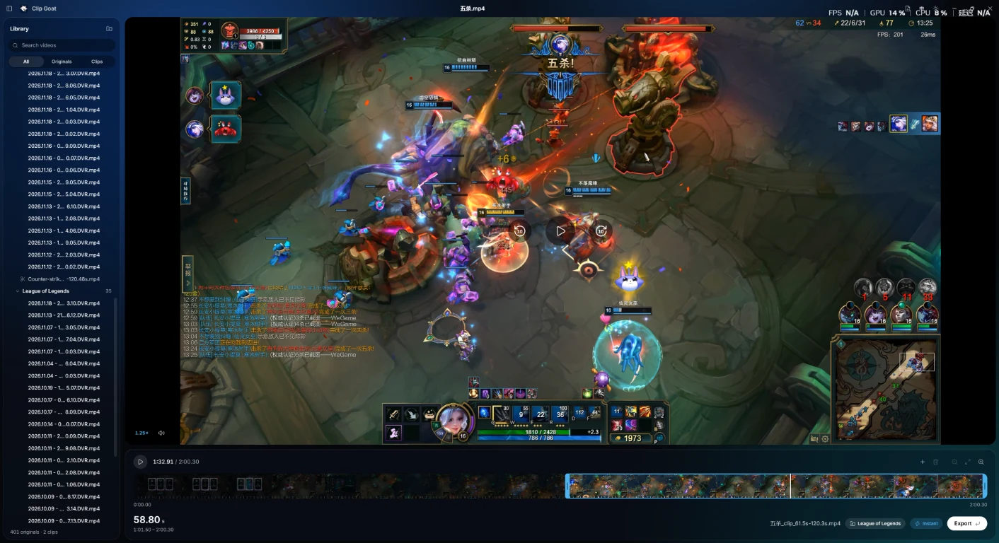

<p align="center"></p>

<h1 align="center">Clip Goat</h1>

<p align="center"></p>

<p align="center"><a id="zh"></a>简体中文 | <a href="#en">English</a></p>

Clip Goat 是一个轻量且高效的视频高光摘取与素材整理工具，基于 ffmpeg、使用 Electron、React 和 TypeScript 构建，同时提供命令行。

**下载**：在 [Releases](https://github.com/takosenpai2687/clip-goat/releases/latest) 页面获取 Windows 安装包（64 位）或 macOS 磁盘映像（Apple Silicon）。Windows 版安装后可在应用内一键更新；macOS 版由自动构建生成，没有在实机上测试过，也没有 Apple 开发者签名，首次打开前需要在终端执行 `xattr -cr "/Applications/Clip Goat.app"`。

## 适用场景

Clip Goat 适用于"视频很长、需要的部分很短"的情况，例如游戏回放、屏幕录制、直播存档、监控录像和手机拍摄的素材。

以游戏回放为例：NVIDIA 即时重放这类功能每次保存最近一段固定时长的录像，一段 2 分钟的 4K60 录像约 700 MB，其中值得保留的部分通常只有十几秒。录像数量增长后难以查找，也占用大量磁盘空间。

<p align="center">
  
</p>

Clip Goat 针对这个过程设计：启动后列出"视频"文件夹里的全部录像，截出需要的十几秒，再把原片移到回收站，把片段归到合适的文件夹。

## 为什么做 Clip Goat

从一段录像里截取十几秒是一件很小的事，但常见的做法都比这件事本身重：

- **专业剪辑软件**（如 Premiere Pro、DaVinci Resolve）是为完整的制作流程设计的。截取一个片段需要新建工程、导入素材、放上时间线、设置导出参数，导出时通常会重新编码。
- **ffmpeg 命令行**速度快、不损画质，但需要自己找时间点、手写参数，操作时看不到画面。
- **两者都不管截完之后的文件。** 原片和片段混在同一批文件夹里，很难分辨哪些录像已经处理过。

> **Clip Goat 只做一件事：在视频上定一个起点和一个终点，然后快速导出这两点之间的片段。**

*其余的步骤都被省掉了：不用新建工程，不用铺时间线，不用填导出参数，不用给文件起名。*

它不能替代剪辑软件：没有转场、字幕、调色和多轨时间线。

## 功能

- ✂️ **截取片段**：拖动起点和终点手柄，按回车导出
- ⚡ **秒出**：起点在关键帧上时不重新编码，画质与原片一致
- 🎯 **精确到帧**：起点不在关键帧上时自动重新编码
- 🧩 **多段拼接**：多个片段合并为一个文件
- 🔁 **片段可以再剪**：来源记录在文件元数据里，原视频删除后仍可继续剪
- 🗂️ **工作区**：文件夹树，片段排在所属原片下方，支持搜索、移动、重命名和删除
- 🗑️ **释放空间**：导出后可一键把原视频移到回收站
- 🔊 **保留全部音轨**
- 🎞️ **常见格式**：MP4、MKV、MOV、WebM、AVI、FLV 等
- 📦 **内置 ffmpeg**：不需要另外安装
- 🔄 **一键更新**：启动时自动检查新版本，也可以点标题栏的更新图标手动检查；确认后自动下载并安装
- ⌨️ **命令行**：`clip-goat` 命令，与桌面应用共用裁切逻辑
- 🌗 **界面**：深色和浅色主题，中文和英文

## 使用

1. **打开**：把视频拖进窗口，或在左侧工作区里点击。
2. **选取**：拖动时间轨两端的手柄。
3. **导出**：按回车，确认文件名后再按一次回车。
4. **清理**（可选）：导出后点"删除原视频"，把原片移到回收站。

片段默认保存在原视频旁边，命名为 `{原文件名}_clip_{起点}s-{终点}s.mp4`，重名时自动加序号。

- 导出按钮左侧的两个标记分别显示导出位置和导出方式（"秒出"或"精确"）。点击前者可更改文件夹；点击"精确"可把起点对齐到关键帧，改为秒出。
- 鼠标移到预览画面上时，会出现播放、后退、前进、音量和倍速控制。右键后退或前进按钮可更改跨度；音量和倍速只影响预览。
- 起点手柄会吸附到附近的关键帧，按住 `Alt` 可关闭吸附。

### 快捷键

| 按键 | 作用 |
|---|---|
| `空格` | 播放或暂停。从选区内开始播放时只播放选区 |
| `I` / `O` | 将起点 / 终点设为当前位置 |
| `M` | 静音或取消静音 |
| `↑` / `↓` | 调高 / 调低音量 |
| `J` / `L` | 后退 / 前进一个跨度（默认 5 秒），不中断播放 |
| `←` / `→` | 移动一帧，按住 `Shift` 移动 1 秒 |
| `S` | 在当前位置切开片段；当前位置不在选区内时新增一个片段 |
| `Delete` | 删除选中的片段 |
| `回车` | 导出 |
| `Esc` | 取消导出 |
| `Ctrl+O` | 打开视频 |
| `Ctrl+Z` | 撤销上一次删除或重命名 |
| 滚轮 | 缩放时间轨，按住 `Shift` 平移 |

## 命令行

```powershell
clip-goat -i Game.mp4 -s 112.5 -e 115.8
```

命令执行成功时，在标准输出打印导出文件的路径，退出码为 0。失败时在标准错误输出打印原因，退出码非 0。

| 参数 | 说明 |
|---|---|
| `-i, --input` | 输入视频 |
| `-s, --start` | 起点，单位为秒，支持小数 |
| `-e, --end` | 终点，单位为秒，支持小数 |
| `--segments` | 多个片段，按顺序拼接，格式为 `起-止,起-止` |
| `-o, --output` | 输出路径，支持 `.mp4`、`.mov`、`.mkv` |
| `--out-dir` | 输出文件夹，文件名自动生成 |
| `--fast` | 从起点之前最近的关键帧开始流复制 |
| `--force-encode` | 强制重新编码 |
| `--overwrite` | 覆盖已存在的输出文件 |
| `--json` | 以 JSON 格式输出结果 |

不指定 `--fast` 或 `--force-encode` 时，行为与桌面应用相同：起点位于关键帧则流复制，否则重新编码。流复制失败时自动改为重新编码。

示例：

```powershell
clip-goat -i Game.mp4 --segments 10-15,42.5-48
clip-goat -i Game.mp4 -s 112.5 -e 115.8 --out-dir D:\clips --json
```

## 已知限制

- 流复制只能从关键帧开始，因此"秒出"的起点精度取决于视频的关键帧间隔。
- 重新编码输出 8 位色的 H.264。HDR 视频重新编码后颜色会变淡，这类视频应使用流复制。
- 预览画面与导出结果可能相差一帧，可变帧率的视频更明显。
- 多段拼接时，每个接缝处会多出约 20 到 100 毫秒的画面，音画保持同步。

## 开发

构建环境要求 Node.js 20 或以上。

```powershell
git clone https://github.com/takosenpai2687/clip-goat.git
cd clip-goat
npm install
npm run dist
```

安装包生成在 `release` 文件夹中。只使用命令行时，执行 `npm install` 和 `npm run build` 后运行 `npm link`，即可在任意目录使用 `clip-goat` 命令。

`npm run dist` 为当前系统打包：在 Windows 上生成安装包，在 macOS 上生成 `.dmg`（Intel 和 Apple Silicon 均可）。macOS 版本没有在实机上测试过，使用临时签名。应用内更新和撤销删除只在 Windows 上可用。

推送形如 `v1.2.3` 的标签后，GitHub Actions 会构建 Windows x64 安装包和 macOS Apple Silicon 磁盘映像，并放进一个草稿 Release；发布说明取自 `docs/release-notes/1.2.3.md`。

中国大陆的网络环境下，安装依赖前需要设置镜像：

```powershell
$env:ELECTRON_MIRROR="https://npmmirror.com/mirrors/electron/"
$env:ELECTRON_BUILDER_BINARIES_MIRROR="https://npmmirror.com/mirrors/electron-builder-binaries/"
$env:FFMPEG_BINARIES_URL="https://cdn.npmmirror.com/binaries/ffmpeg-static"
npm install --registry=https://registry.npmmirror.com
```

| 目录 | 内容 |
|---|---|
| `shared/` | 裁切、视频信息读取、文件命名，桌面应用和命令行共用 |
| `cli/` | 命令行入口 |
| `electron/` | 主进程：窗口、本地视频读取、工作区、导出任务、自动更新 |
| `renderer/` | 界面，React + Vite |
| `dist/` | TypeScript 编译产物（不入库） |
| `assets/` | 图标和标志 |

环境变量 `CLIP_GOAT_FFMPEG` 和 `CLIP_GOAT_FFPROBE` 可以指定使用其他的 ffmpeg 和 ffprobe。

## 许可

本项目以 GPL-3.0-or-later 许可发布。内置的 ffmpeg 为 GPL 构建。

---

<h1 align="center"><a id="en"></a>Clip Goat (English)</h1>

<p align="center"><a href="#zh">简体中文</a> | English</p>

Clip Goat is a lightweight and efficient tool for pulling highlights out of videos and organising your footage. It is powered by ffmpeg, built with Electron, React and TypeScript, and ships with a command-line interface.

**Download**: get the Windows installer (64-bit) or the macOS disk image (Apple Silicon) from the [Releases](https://github.com/takosenpai2687/clip-goat/releases/latest) page. Once installed, the Windows app updates itself in one click. The macOS build comes from an automated build, has not been tested on a real Mac and has no Apple developer signature; before the first launch, run `xattr -cr "/Applications/Clip Goat.app"` in Terminal.

## Use cases

Clip Goat suits any situation where the video is long and the part you need is short: game replays, screen recordings, stream archives, security footage, and footage shot on a phone.

Game replays are a typical example. Features such as NVIDIA Instant Replay save the last fixed stretch of gameplay each time. A 2-minute 4K60 recording is about 700 MB, and the part worth keeping is usually only a dozen seconds or so. As recordings pile up, they become hard to find and take up a lot of disk space.

<p align="center">
  
</p>

Clip Goat is designed around this workflow: it lists every recording in your Videos folder on launch, cuts out the dozen seconds you need, then moves the original to the Recycle Bin and files the clip in the folder where it belongs.

## Why Clip Goat

Cutting a dozen seconds out of a recording is a small job, but the usual ways of doing it are heavier than the job itself:

- **Professional editors** such as Premiere Pro or DaVinci Resolve are built for full productions. To cut one clip you create a project, import the footage, place it on a timeline and choose export settings, and the export normally re-encodes the video.
- **The ffmpeg command line** is fast and lossless, but you have to find the timestamps yourself, write the arguments by hand, and you cannot see the picture while doing it.
- **Neither helps with the files afterwards.** Originals and clips end up mixed in the same folders, and it is hard to tell which recordings have already been dealt with.

> **Clip Goat does one thing: you set a start point and an end point in a video, and it quickly exports the part between them as a new file.**

*Everything else is left out: no project to create, no timeline to arrange, no export settings to fill in, no file name to think up.*

It is not a replacement for a video editor. It has no transitions, titles, colour tools or multi-track timeline.

## Features

- ✂️ **Clipping**: drag the start and end handles, press Enter to export
- ⚡ **Instant export**: no re-encoding when the start sits on a keyframe; quality is identical to the original
- 🎯 **Frame-exact cuts**: re-encodes automatically when the start is not on a keyframe
- 🧩 **Joining ranges**: several ranges merged into one file
- 🔁 **Clips of clips**: the source is recorded in the file metadata, so clips can be cut again even after the original is deleted
- 🗂️ **Workspace**: a folder tree with clips listed under the video they came from; search, move, rename and delete
- 🗑️ **Free up space**: move the original to the Recycle Bin in one click after an export
- 🔊 **All audio tracks kept**
- 🎞️ **Common formats**: MP4, MKV, MOV, WebM, AVI, FLV and more
- 📦 **Bundled ffmpeg**: no separate installation
- 🔄 **One-click updates**: checks for a new version on launch, or on demand from the update icon in the title bar; downloads and installs it once you confirm
- ⌨️ **Command line**: the `clip-goat` command shares the cutting logic of the desktop app
- 🌗 **Interface**: dark and light themes, English and Chinese

## Usage

1. **Open**: drop a video onto the window, or click one in the workspace on the left.
2. **Select**: drag the handles at either end of the timeline.
3. **Export**: press Enter, confirm the file name, and press Enter again.
4. **Clean up** (optional): after the export, click "Delete original" to move the original to the Recycle Bin.

Clips are saved next to the source video as `{original-name}_clip_{start}s-{end}s.mp4`; a number is appended if the name is taken.

- The two chips to the left of the Export button show the destination and the export mode ("Instant" or "Exact"). Click the first to change the folder; click "Exact" to move the start onto a keyframe and export instantly.
- When the pointer is over the preview, controls for play, back, forward, volume and speed appear. Right-click back or forward to change the skip amount; volume and speed affect the preview only.
- The start handle snaps to nearby keyframes; hold `Alt` to turn snapping off.

### Keyboard shortcuts

| Key | Action |
|---|---|
| `Space` | Play or pause. When playback starts inside the selection, only the selection plays |
| `I` / `O` | Set the start / end to the current position |
| `M` | Mute or unmute |
| `↑` / `↓` | Raise / lower the volume |
| `J` / `L` | Jump back / ahead by the skip amount (5 seconds by default) without stopping playback |
| `←` / `→` | Move one frame; hold `Shift` to move 1 second |
| `S` | Split the range at the current position; outside a range, add a new one |
| `Delete` | Remove the selected range |
| `Enter` | Export |
| `Esc` | Cancel the export |
| `Ctrl+O` | Open a video |
| `Ctrl+Z` | Undo the last delete or rename |
| Mouse wheel | Zoom the timeline; hold `Shift` to pan |

## Command line

```powershell
clip-goat -i Game.mp4 -s 112.5 -e 115.8
```

On success the command prints the path of the exported file to standard output and exits with code 0. On failure it prints the reason to standard error and exits with a non-zero code.

| Option | Description |
|---|---|
| `-i, --input` | Input video |
| `-s, --start` | Start in seconds; decimals allowed |
| `-e, --end` | End in seconds; decimals allowed |
| `--segments` | Several ranges joined in order, written as `start-end,start-end` |
| `-o, --output` | Output path; `.mp4`, `.mov` and `.mkv` are supported |
| `--out-dir` | Output folder; the file name is generated automatically |
| `--fast` | Stream copy from the nearest keyframe before the start |
| `--force-encode` | Always re-encode |
| `--overwrite` | Overwrite an existing output file |
| `--json` | Print the result as JSON |

Without `--fast` or `--force-encode`, the behaviour matches the desktop app: stream copy when the start sits on a keyframe, re-encode otherwise. If stream copy fails, it falls back to re-encoding.

Examples:

```powershell
clip-goat -i Game.mp4 --segments 10-15,42.5-48
clip-goat -i Game.mp4 -s 112.5 -e 115.8 --out-dir D:\clips --json
```

## Known limitations

- Stream copy can only start on a keyframe, so the start precision of an "Instant" export depends on the keyframe interval of the video.
- Re-encoding produces 8-bit H.264. HDR videos look washed out after re-encoding and should be exported with stream copy.
- The preview and the exported result may differ by one frame, more noticeably with variable-frame-rate videos.
- When ranges are joined, each seam gains about 20 to 100 ms of extra picture. Audio and video stay in sync.

## Development

Building requires Node.js 20 or later.

```powershell
git clone https://github.com/takosenpai2687/clip-goat.git
cd clip-goat
npm install
npm run dist
```

The installer is written to the `release` folder. To use only the command line, run `npm install` and `npm run build`, then `npm link`; the `clip-goat` command is then available in any directory.

`npm run dist` packages for the system it runs on: an installer on Windows, a `.dmg` on macOS (Intel or Apple Silicon). The macOS build has not been tested on a real Mac and is ad-hoc signed. In-app updates and undoing a delete work on Windows only.

Pushing a tag such as `v1.2.3` makes GitHub Actions build the Windows x64 installer and the macOS Apple Silicon disk image and collect them in a draft release; the notes come from `docs/release-notes/1.2.3.md`.

On networks in mainland China, set these mirrors before installing the dependencies:

```powershell
$env:ELECTRON_MIRROR="https://npmmirror.com/mirrors/electron/"
$env:ELECTRON_BUILDER_BINARIES_MIRROR="https://npmmirror.com/mirrors/electron-builder-binaries/"
$env:FFMPEG_BINARIES_URL="https://cdn.npmmirror.com/binaries/ffmpeg-static"
npm install --registry=https://registry.npmmirror.com
```

| Directory | Contents |
|---|---|
| `shared/` | Cutting, video probing and file naming, shared by the desktop app and the command line |
| `cli/` | Command-line entry point |
| `electron/` | Main process: window, local video access, workspace, export jobs, updates |
| `renderer/` | Interface, React + Vite |
| `dist/` | Compiled TypeScript output (not committed) |
| `assets/` | Icons and logo |

The environment variables `CLIP_GOAT_FFMPEG` and `CLIP_GOAT_FFPROBE` select a different ffmpeg and ffprobe.

## License

Released under GPL-3.0-or-later. The bundled ffmpeg is a GPL build.
